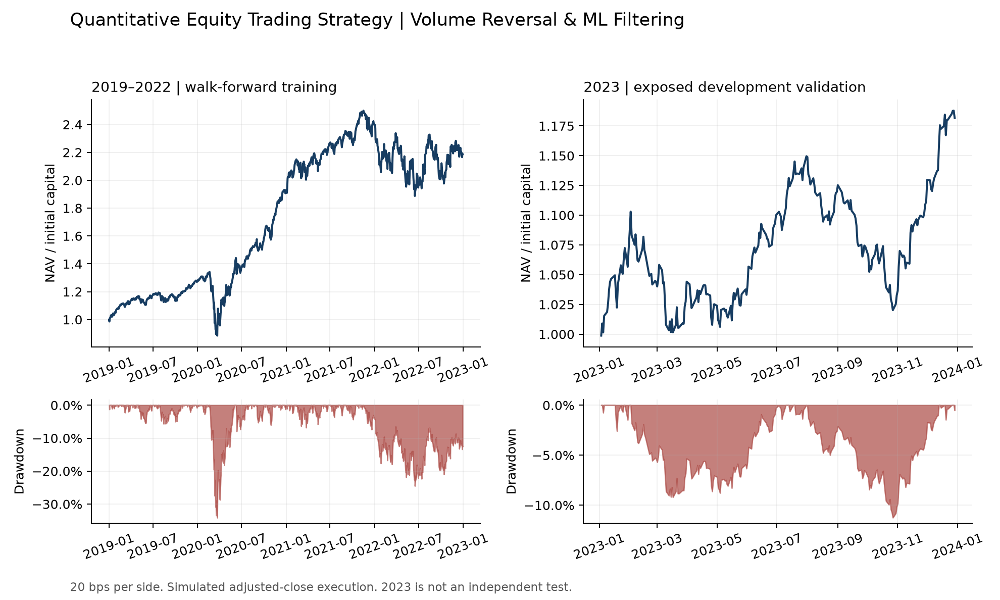

# Quantitative Equity Trading Strategy

**Volume Reversal & ML Filtering**

To everyone who opens this file: thank you for your time and interest in my
work. This is my second quantitative strategy, which I developed independently.
It remains a work in progress, with substantial room for improvement. Through
this project, I aim to put the mathematics, finance and machine learning I have
studied during my undergraduate degree and at NUS into practice, test my
financial intuition, and continue learning through research and experimentation.

An equity research workflow covering security identity, market-data quality,
liquidity screening, event signals, annual walk-forward classification and a
cash-constrained portfolio ledger.

The portfolio starts with a 60% equal-dollar buy-and-hold core and a 40%
volume-reversal sleeve. Logistic regression accepts or rejects proposed active
entries using a threshold derived from past calibrated predictions.

## Research question

Can observable price-volume events identify useful long entries after sharp
short-term declines, and can a simple classifier improve entry selection after
trading costs? The implementation makes timing, cash flows and data exclusions
explicit. The focus is the research process: translating a market hypothesis
into auditable signals, causal model fitting and reproducible evaluation.

## Workflow


## Results

Historical simulated results at **20 bps per side**, including the passive core:

| Evaluation | Universe | Return | Sharpe | Max. drawdown |
|---|---|---:|---:|---:|
| 2019–2022 walk-forward training | Delivered 486 | 21.60% annualised | 0.941 | -34.13% |
| 2023 development validation | Frozen 474 | 18.17% full year | 1.388 | -11.25% |
| 2023 universe sensitivity | Delivered 486 | 18.90% full year | 1.441 | -10.92% |

2023 was inspected repeatedly during research and is **not an untouched
out-of-sample test**. The final selection was influenced by that knowledge.
The 2024–2025 fixed-model test returned **25.99%**
cumulatively (**12.30% annualised**, Sharpe **0.978**, max drawdown **-15.38%**)
on the primary universe at 20 bps per side. See the
[full test report](docs/TEST_REPORT.md), including all cost sensitivities.

See [all nine cost/universe scenarios](docs/final_results.csv),
[methodology](docs/METHODOLOGY.md) and [limitations](docs/LIMITATIONS.md).



## Quick start: supplied local snapshot

Python 3.13; run commands from this repository root:

```bash
python -m venv .venv
# Windows: .venv\Scripts\Activate.ps1
# macOS/Linux: source .venv/bin/activate
python -m pip install -r environment-lock.txt
python -m pytest -q
python scripts/verify_data.py
python run.py
python run.py validation
python scripts/verify_reference.py
```

The result figure is included. To regenerate it, run `scripts/plot_results.py`
in the separate cleaning environment (which includes pandas and matplotlib),
or a separate plotting environment using `requirements-plot.txt`. Keep optional
plotting dependencies outside the exact strategy environment.

The research workspace stores market data in `data_current/`. Data is excluded from the
GitHub source package. On a fresh checkout, supply the documented data snapshot
before running backtests; tests on synthetic inputs work without it. The data
check reports missing files explicitly and verifies SHA-256 without loading
held-out market observations. Default strategy reads end in 2022; the explicit
validation command allows 2023. The separate `python run.py test` command
admits 2024–2025 under the pre-recorded frozen-model protocol. Default training
and validation continue to reject test dates; dates after 2025 are always rejected.

For one-command verification and backtest reproduction after installation:
`python scripts/reproduce.py`. See [validation record](docs/VALIDATION.md).

## Rebuilding the data

The complete acquisition and cleaning implementation lives in `data_pipeline/`,
with its own dependencies and test process to avoid colliding `src` imports.
It includes v3 removal of the Barnes/Barrick identity mismatch and OHLC
enrichment with the documented HUBB exclusion. Its final daily panel and
security master match the strategy snapshot byte for byte.

See [reproduction guide](docs/REPRODUCIBILITY.md) for separate environments,
upstream input requirements, the final handoff command and test coverage.
Raw acquisition checkpoints and intermediate audit datasets were not included
in the source repository; a from-raw rebuild requires those inputs or a new
acquisition. A live vendor download can differ from the historical snapshot.

## Repository map

| Directory | Purpose |
|---|---|
| `data_pipeline/` | Acquisition, cleaning, identity and OHLC pipeline; tests and reports |
| `src/` | Signals, features, classifier, execution ledger and evaluation |
| `configs/` | Frozen strategy specification |
| `models/` | Frozen 2023 classifier, universe and integrity manifest |
| `tests/` | Causality, execution, calibration and boundary checks |
| `scripts/` | Data handoff, integrity verification, reference checks and plots |
| `docs/` | Methods, limitations, results and source provenance |
| `data_current/` | Local market-data snapshot, ignored by Git |
| `results/` | Rebuilt labels, models, ledgers and metrics, ignored by Git |

## Provenance and attribution

Cleaning snapshot: `SSPZs/DSA5205_Proj2`, `main`, commit
`791d62fe013d88795b568f154bc22c4785d6ad58`.
Strategy snapshot: the same repository, `working_wyl`, commit
`65047f2ba1d0017aa18339c15b5fa34f8da2b06d`.
See [source manifest](docs/source_manifest.json) for file hashes.
The source manifest records the origin and integrity of the integrated modules.
