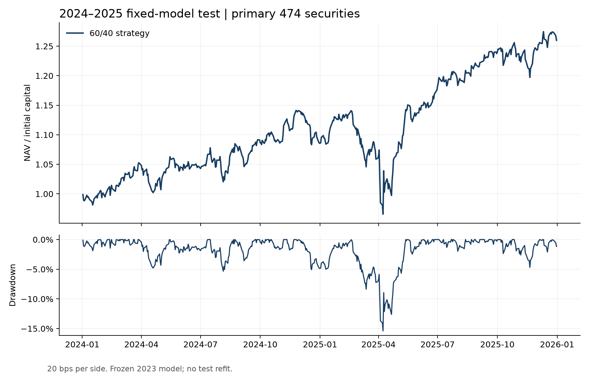

# Frozen-model test: 2024–2025

## Protocol

The evaluation uses the frozen classifier, universe and settings recorded in
`test_protocol.json`, with SHA-256 checks for model and feature integrity.
The frozen 2023 classifier
(latest training label 2022-12-30) and threshold 0.43657775028548135 were used
throughout both years. There was no refitting using 2023 or test labels and no
parameter selection after observing the test results.

This is a **fixed-model holdout evaluation**, not a demonstration of annual
model retraining through 2025. The account starts with fresh capital at the
first 2024 session and continues through the end of 2025; it does not carry
2023 positions. The primary 474-security universe remains frozen from 2022.
The delivered 486-security pool and 10/30 bps fees are predefined sensitivities.

## Main results

20 bps transaction cost per side; initial 60% passive core / 40% active sleeve:

| Portfolio | Cumulative return | Annualised return | Sharpe | Max drawdown |
|---|---:|---:|---:|---:|
| Strategy, primary 474 | 25.99% | 12.30% | 0.978 | -15.38% |
| Strategy, delivered 486 | 25.53% | 12.09% | 0.956 | -15.70% |

The primary strategy's average stock exposure was 70.37%. These results
document the behaviour of the proposed research workflow under frozen settings.
Returns include both the passive core and active sleeve; they do not isolate
the active signal or ML contribution.

## Calendar-year returns

| Primary 474, 20 bps | Calendar return | Sharpe | Within-year max drawdown |
|---|---:|---:|---:|
| 2024 | 8.57% | 0.913 | -5.34% |
| 2025 | 16.05% | 1.059 | -15.36% |

The ledger is continuous between years. Calendar returns compound to the
two-year return; drawdown peaks for this table restart at each year's opening
capital. Annualised metrics use the implementation's 252-session convention.

## Cost sensitivity

| Primary 474 | Cumulative return | Annualised return | Sharpe |
|---|---:|---:|---:|
| 10 bps per side | 26.88% | 12.69% | 1.006 |
| 20 bps per side | 25.99% | 12.30% | 0.978 |
| 30 bps per side | 25.12% | 11.91% | 0.949 |



## Reproduce and interpret

```bash
python run.py test
python scripts/verify_reference.py all
```

`test_results.csv` records all six cost/universe scenarios;
`test_yearly.csv` records all annual breakdowns. `test_summary.json` records
243,972 test stock-day rows and the frozen model's training boundary.
Local daily ledgers are in `results/test/` and are excluded from the source ZIP.

The 2024–2025 period is the held-out evaluation interval for this specification.
Strategy revisions selected using these results require a separate evaluation
period.
The fixed reference universe, incomplete delisting coverage, vendor repairs
and adjusted-close execution limitations remain. A calendar holdout does not
remove those data and simulation biases.
